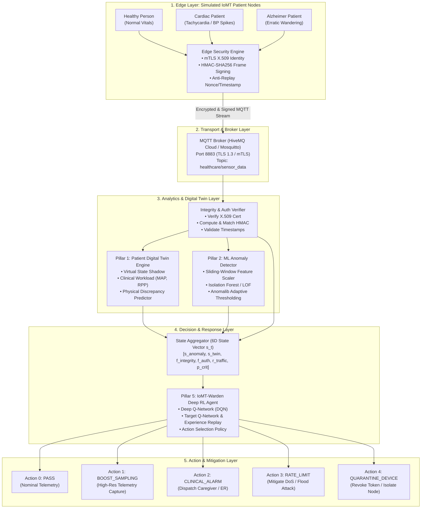

## For future Claude
This is the master architecture and synthesis document for the Major Project: Secure IoMT Monitoring System. It unifies the baseline telemetry simulation with the five advanced security pillars (Digital Twin, ML Anomaly Detection, mTLS Device Auth, HMAC Integrity, and Deep RL Threat Response).

# Secure IoMT Monitoring System: Master Architecture & Synthesis

## 1. Executive Summary
This project designs and implements an intelligent, resilient **Internet of Medical Things (IoMT)** security ecosystem. Modern healthcare IoT systems are vulnerable to sensor spoofing, man-in-the-middle tampering, denial-of-service, and delayed emergency detection. 

Our system solves these challenges by integrating **real-time clinical telemetry** with a **5-Pillar Defense Framework**:
1. **Digital Twin Integration**: Real-time virtual state mirroring & cyber-physical discrepancy estimation.
2. **ML-Based Anomaly Detection**: Streaming feature extraction with adaptive statistical thresholding.
3. **Secure Device Authentication**: Zero-trust Mutual TLS (mTLS) with X.509 device certificates.
4. **Data Integrity Protection**: Frame-level HMAC-SHA256 signatures with anti-replay timestamps.
5. **RL-Based Threat Response**: Deep Q-Network (DQN) autonomous security agent operating within an IoMT Gymnasium environment.

---

## 2. Provenance & Harvested Foundations

```
+---------------------------------------------------------------------------------------------------+
|                                  Harvested Foundation Matrix                                      |
+---------------------------------------------------------------------------------------------------+
| Component                | Source Repository                            | Core Reused Asset       |
+--------------------------+----------------------------------------------+-------------------------+
| Telemetry Simulation     | Divyansh121699/IoT-Based-Healthcare-Security | Multi-persona generators|
| Pillar 1: Digital Twin   | Open-Source-Digital-Twin/digital-twin-playgr | Sync & discrepancy schema|
| Pillar 2: ML Anomaly     | ncl427/ML-based-Anomaly-Detection            | Streaming sliding window|
|                          | open-edge-platform/anomalib                  | Adaptive thresholding   |
| Pillar 3: Device Auth    | Python cryptography / X.509                  | Zero-trust mTLS pipeline|
| Pillar 4: Data Integrity | Python hmac / hashlib                        | Frame HMAC-SHA256       |
| Pillar 5: RL Defense     | mmalam3/IoTWarden-Deep-RL-based-Security     | Custom Gym env & DQN net|
|                          | Kim-Hammar/awesome-rl-for-cybersecurity      | ACD MDP reward equations|
+---------------------------------------------------------------------------------------------------+
```

---

The repositories in the matrix below are design references; the matrix does not imply verbatim reuse or that every proposed capability is complete.

## 3. End-to-End System Architecture



---

## 4. Deep Specification of the 5 Pillars

### Pillar 1: Digital Twin Integration
- **Role**: Maintains a live computational model of the patient’s cardiovascular and neurological status.
- **Derived Metrics**:
  - **Mean Arterial Pressure (MAP)**: $MAP = \frac{1}{3} BP_{sys} + \frac{2}{3} BP_{dia}$ (target range: 70–100 mmHg).
  - **Rate Pressure Product (RPP)**: $RPP = HR \times BP_{sys}$ (estimates myocardial oxygen demand; $>12,000$ indicates stress).
  - **Wandering Drift Velocity**: $v = \frac{\Delta \text{Haversine}(lat, lon)}{\Delta t}$.
- **Cyber-Physical Discrepancy**: Computes normalized difference $s_{twin} = \|\mathbf{y}_{actual} - \hat{\mathbf{y}}_{predicted}\|_2$. Sharp discrepancies indicate sensor failure or injection attacks.

### Pillar 2: ML-Based Anomaly Detection
- **Feature Vector**: 8-dimensional vector: $[HR, BP_{sys}, BP_{dia}, Temp, SpO_2, \Delta LatLon, \frac{d(HR)}{dt}, \frac{d(BP)}{dt}]$.
- **Ensemble Model**: Fast unsupervised Isolation Forest + K-Means cluster distance.
- **Adaptive Thresholding (Anomalib Pattern)**:
  - Dynamic score: $s \in [0.0, 1.0]$.
  - Warning Threshold: $Th_{warn} = \mu_s + 2.0\sigma_s$.
  - Critical Threshold: $Th_{crit} = \mu_s + 3.5\sigma_s$.

### Pillar 3: Secure Device Authentication
- **Zero-Trust mTLS**: Both broker and sensor nodes present signed X.509 certificates generated via elliptic curve cryptography (ECDSA `secp256r1`).
- **Device Identity Token**: Lightweight signed JWT / ECDSA identity assertions included in handshake metadata.

### Pillar 4: Data Integrity Protection
- **Frame-Level HMAC-SHA256**: Every telemetry packet includes a cryptographic hash of the payload generated with a pre-shared device secret:
  $$HMAC = \mathcal{H}_{SHA256}(K_{device}, \text{canonical}(payload) \parallel timestamp \parallel nonce)$$
- **Anti-Replay Validation**: Packets older than $\Delta t_{max} = 5\text{s}$ or with seen nonces are rejected immediately.

### Pillar 5: RL-Based Threat Response (IoMT-Warden)
- **MDP Tuple**: $\mathcal{M} = \langle \mathcal{S}, \mathcal{A}, \mathcal{P}, \mathcal{R}, \gamma \rangle$.
- **State Vector $\mathbf{s}_t \in \mathbb{R}^6$**:
  1. $s_{anomaly}$: Anomaly score from ML pipeline $[0, 1]$.
  2. $s_{twin}$: Deviation from Digital Twin prediction $[0, 1]$.
  3. $f_{integrity}$: HMAC integrity flag (0 = Valid, 1 = Tampered).
  4. $f_{auth}$: Authentication state (0 = Valid mTLS, 1 = Invalid).
  5. $r_{traffic}$: Packet arrival rate relative to baseline $[0, 1]$.
  6. $p_{crit}$: Patient clinical vulnerability index $[0, 1]$.
- **Actions $\mathcal{A}$**: `{0: PASS, 1: BOOST_SAMPLING, 2: CLINICAL_ALARM, 3: RATE_LIMIT, 4: QUARANTINE_DEVICE}`.
- **Reward Function $\mathcal{R}$**:
  $$\mathcal{R}(s, a) = +10 \cdot \mathbb{I}_{crisis\_alert} + 10 \cdot \mathbb{I}_{quarantine\_attack} - 5 \cdot \mathbb{I}_{false\_alert} - 15 \cdot \mathbb{I}_{quarantine\_genuine}$$
- **DQN Architecture**: 2 hidden layers (64 units each, ReLU), target network sync every 100 steps, experience replay capacity 10,000 transitions.

---

## 5. Unified Telemetry Payload Schema

```json
{
  "header": {
    "device_id": "sensor_node_02",
    "patient_id": 2,
    "timestamp": "2026-10-31T21:00:00.000Z",
    "nonce": "a7f3c2e190b4d45e",
    "schema_version": "2.0"
  },
  "telemetry": {
    "heart_rate": 145,
    "blood_pressure_systolic": 175,
    "blood_pressure_diastolic": 110,
    "body_temperature": 37.1,
    "oxygen_saturation": 96,
    "latitude": 38.8462,
    "longitude": 77.3064
  },
  "security": {
    "auth_token": "eyJhbGciOiJFUzI1NiIsInR5cCI6IkpXVCJ9...",
    "hmac_sha256": "8f4b23d91c7a40b9e8316279f61b1836f3284534e32049e6f3b01859c765f028"
  }
}
```

---

## 6. Implementation Codebase Structure

```
major/
├── IoT-Based-Healthcare-Security-Project/  # Cloned GMU baseline
├── major project/                          # Obsidian Second Brain Vault
└── iomt_security/                          # Unified Python Implementation
    ├── __init__.py
    ├── config.py                           # Environment configurations & keys
    ├── edge/
    │   ├── __init__.py
    │   ├── telemetry_generator.py          # Refactored async Healthy, Cardiac, Alzheimer models
    │   ├── crypto_signer.py                # HMAC-SHA256 & anti-replay generation
    │   └── edge_publisher.py               # Async MQTT TLS publisher
    ├── server/
    │   ├── __init__.py
    │   ├── integrity_verifier.py           # HMAC & timestamp verification
    │   ├── digital_twin_engine.py          # Pillar 1: State mirror & strain metrics
    │   ├── ml_anomaly_detector.py          # Pillar 2: Sliding-window + adaptive threshold
    │   ├── device_auth_manager.py          # Pillar 3: mTLS & X.509 cert validation
    │   └── broker_subscriber.py            # Real-time telemetry receiver
    ├── rl_agent/
    │   ├── __init__.py
    │   ├── iomt_gym_env.py                 # Gymnasium environment (state, action, reward)
    │   ├── dqn_network.py                  # PyTorch DQN & target network
    │   ├── replay_buffer.py                # Experience replay memory
    │   └── agent_trainer.py                # Training & inference mitigation loop
    └── main.py                             # Master runner & simulation demonstrator
```

## Related Notes
- [[wiki/projects/iot-healthcare-security]]
- [[wiki/concepts/five-pillar-security-architecture]]
- [[wiki/concepts/external-repo-evaluations]]
- [[wiki/concepts/digital-twin-iomt-integration]]
- [[wiki/concepts/ml-anomaly-detection-pipeline]]
- [[wiki/concepts/deep-rl-threat-response-iotwarden]]
- [[wiki/decisions/2026-10-31-external-libraries-and-framework-selection]]
- [[boards/project-board]]

## Implementation Reconciliation
This document captures the intended integrated architecture. The current workspace has a Python pipeline and dashboards, but the source snapshot does not establish mTLS/X.509 provisioning as implemented, and benchmark method 3 uses threshold action selection plus the safety shield. Treat architecture diagrams and action descriptions as target design unless confirmed in source. See [[wiki/projects/iot-healthcare-security]], [[wiki/concepts/five-pillar-security-architecture]], and [[wiki/concepts/research-benchmark-evaluation-50k]].

## Implementation Reconciliation
This document captures the intended integrated architecture. The current workspace has a Python pipeline and dashboards, but the source snapshot does not establish mTLS/X.509 provisioning as implemented, and benchmark method 3 uses threshold action selection plus the safety shield. Treat architecture diagrams and action descriptions as target design unless confirmed in source. See [[wiki/projects/iot-healthcare-security]], [[wiki/concepts/five-pillar-security-architecture]], and [[wiki/concepts/research-benchmark-evaluation-50k]].
